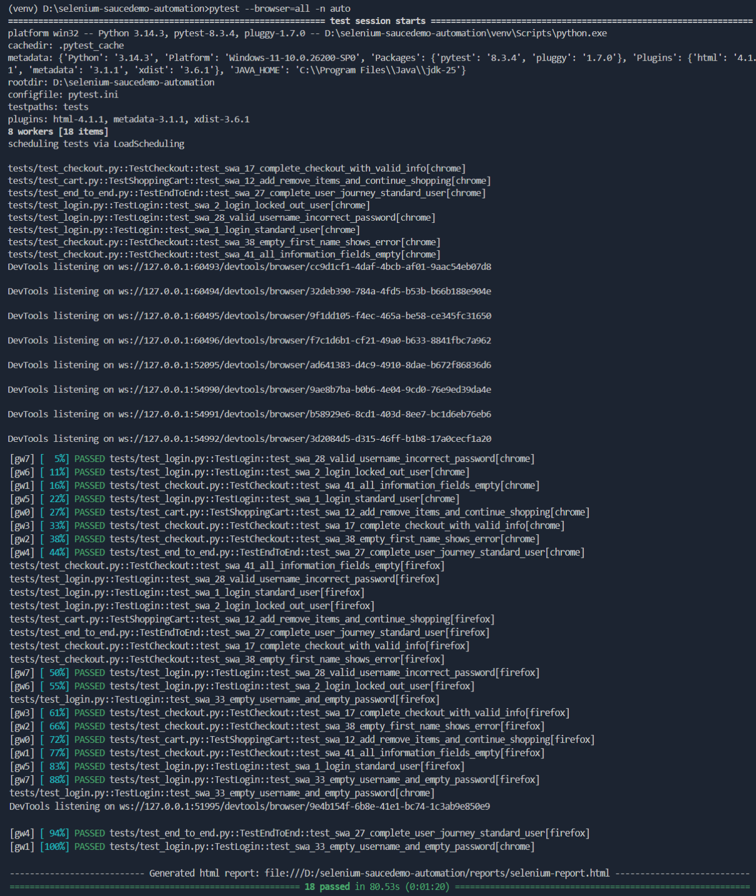
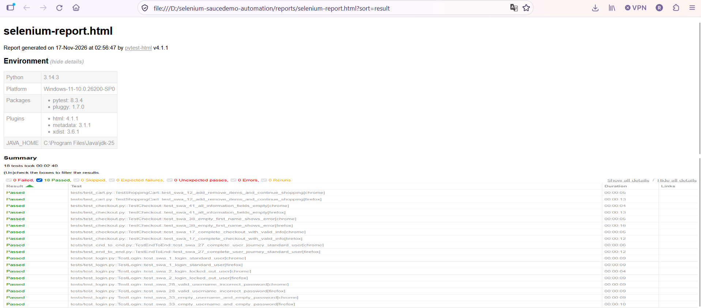

# Selenium Test Automation: SauceDemo


UI test automation for [SauceDemo](https://www.saucedemo.com) built with **Selenium WebDriver**, **Python**, and **pytest**, using the Page Object pattern. Each test comes from a manual test case I wrote and ran earlier (see [manual-qa-portfolio](https://github.com/obyy47/manual-qa-portfolio)), and its name carries the Qase test case ID. Every test runs in both Chrome and Firefox, and the results are written to a self-contained HTML report.

---

## Key features

- **Page Object pattern:** one class per page, with locators and actions kept out of the tests.
- **Explicit waits only:** `BasePage` wraps `WebDriverWait`, so tests wait for an element to be visible or clickable and do not use fixed sleeps.
- **Cross-browser:** the `--browser` option runs the suite on Chrome, Firefox, or both (`--browser=all`).
- **Headless mode:** the `--headless` option runs the browsers without a window, which is what CI uses.
- **Clean state for every test:** a pytest fixture opens a fresh browser per test and closes it afterwards.
- **Parallel runs:** `pytest-xdist` lets the 18 test runs execute on several workers (`-n auto`).
- **Reporting:** `pytest-html` generates a self-contained report at `reports/selenium-report.html`.
- **CI:** a GitHub Actions workflow runs the suite on Chrome and Firefox and uploads the report.

---

## Automated scenarios (9 tests, 18 runs)

Each test runs once per browser, so 9 tests give 18 test runs.

| Test file | Test | Qase test case | What it verifies |
|---|---|---|---|
| `test_login.py` | Log in with `standard_user` | SWA-1 | The URL contains `inventory.html` |
| `test_login.py` | `locked_out_user` is rejected | SWA-2 | Error message says the user has been locked out |
| `test_login.py` | Valid username with incorrect password | SWA-28 | Error message says username and password do not match |
| `test_login.py` | Empty username and empty password | SWA-33 | Error message says the username is required |
| `test_cart.py` | Add 3 items, remove 2, and continue shopping | SWA-12 | Badge shows 3, the cart lists 3 items, the badge shows 1 after removing 2, and the remaining item still shows a Remove button |
| `test_checkout.py` | All information fields empty | SWA-41 | Error message says First Name is required |
| `test_checkout.py` | Empty First Name | SWA-38 | Error message says First Name is required |
| `test_checkout.py` | Complete checkout with valid information | SWA-17 | The overview page opens, the order completes with "Thank you for your order!", and Back Home resets the cart badge |
| `test_end_to_end.py` | Full user journey with `standard_user` | SWA-27 | Login, 2 items in the cart, the overview total is $43.18, the order completes, the cart is empty, and logout returns to the login page |

### Not automated, and why

- **`problem_user`, `error_user`, and `visual_user` cases:** these accounts have intentional bugs, which I covered in manual testing and reported in Jira.
- **Visual layout and delay checks:** better verified manually.
- **Empty-cart and whitespace-only checkout:** known issues found in manual testing, so an automated test would fail by design.

---

## Results

All 18 test runs passed (9 tests on Chrome and Firefox), with 0 failures. Run on Windows 11 with Python 3.14.3, pytest 8.3.4, and 8 parallel workers: **18 passed in 80.53 s**.

| Terminal run | HTML report |
|---|---|
|  |  |

The latest report is committed at [`reports/selenium-report.html`](reports/selenium-report.html). Download it and open it in a browser.

---

## Getting started

### Prerequisites

- Python 3.12 or newer (I ran it locally on 3.14, and CI is set up for 3.12)
- Google Chrome and/or Mozilla Firefox installed

Selenium Manager (included in Selenium 4) finds the matching browser drivers, so no manual driver download is needed.

### Installation

```bash
git clone https://github.com/obyy47/selenium-saucedemo-automation.git
cd selenium-saucedemo-automation

python -m venv venv
venv\Scripts\activate          # Windows
# source venv/bin/activate     # macOS / Linux

pip install -r requirements.txt
```

### Run the tests

```bash
# Chrome only (default)
pytest

# Firefox only
pytest --browser=firefox

# Chrome and Firefox
pytest --browser=all

# Headless
pytest --browser=all --headless

# In parallel on all available CPU cores
pytest --browser=all -n auto

# One test file, or one test
pytest tests/test_login.py
pytest -k swa_17
```

`pytest.ini` already adds `-v` and writes the HTML report to `reports/selenium-report.html` on every run.

### Command line options

| Option | Values | Default | Description |
|---|---|---|---|
| `--browser` | `chrome`, `firefox`, `all` | `chrome` | Browser(s) to run the tests on |
| `--headless` | flag | off | Run the browser without a window |

---

## Continuous integration

[`.github/workflows/selenium-ci.yml`](.github/workflows/selenium-ci.yml) runs on every push and pull request to `main`:

1. Check out the repository
2. Set up Python 3.12 with the pip cache
3. Install the dependencies from `requirements.txt`
4. Run `pytest --browser=all --headless`
5. Upload `reports/selenium-report.html` as the `selenium-html-report` artifact (kept for 14 days, uploaded even when tests fail)

---

## How the framework is organized

```text
selenium-saucedemo-automation/
├── .github/
│   └── workflows/
│       └── selenium-ci.yml        # GitHub Actions workflow
├── pages/                         # Page Objects
│   ├── base_page.py               # Explicit waits and shared actions (click, type, read text)
│   ├── login_page.py
│   ├── inventory_page.py
│   ├── cart_page.py
│   └── checkout_page.py
├── tests/
│   ├── conftest.py                # --browser and --headless options, driver fixture
│   ├── test_login.py
│   ├── test_cart.py
│   ├── test_checkout.py
│   └── test_end_to_end.py
├── reports/
│   └── selenium-report.html       # Latest HTML report
├── screenshots/                   # Terminal run and HTML report captures
├── pytest.ini                     # pytest settings and report options
├── requirements.txt
├── .gitignore
└── README.md
```

**How it fits together**

- `BasePage` holds the shared actions and the explicit waits. Page classes extend it and only define their locators and page-specific actions.
- Tests contain the steps and the assertions. They never use locators directly.
- `conftest.py` turns the `--browser` option into a parameter (`[chrome]` and `[firefox]` in the test names) and creates the driver fixture. For Chrome it turns off the password manager and the password leak popup, which would otherwise cover the page during tests.

---

## Notes and limitations

- **Public demo site.** SauceDemo is a practice site, and its markup can change, which would require updating the locators in the page objects.
- **Test data is hardcoded** in the tests (public demo accounts and sample customer data).
- **A new browser for every test.** This keeps the tests independent, but it makes each test slower than sharing one browser.
- **No screenshot on failure and no retries** in the current setup.
- **`pytest-xdist` is used locally** for parallel runs. The CI workflow runs the tests sequentially.

## Next improvements

- Capture a screenshot when a test fails and attach it to the HTML report
- Move the test data and the base URL into a config file or environment variables
- Add pytest markers (for example `smoke` and `regression`) to run subsets of the suite
- Add Selenium versions of the Security scenarios (access without login)
- Compare with the [WebdriverIO version](https://github.com/obyy47/wdio-saucedemo-automation) of the same scenarios
